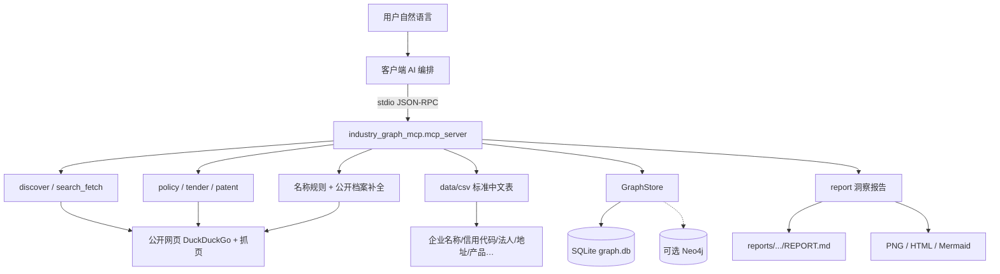
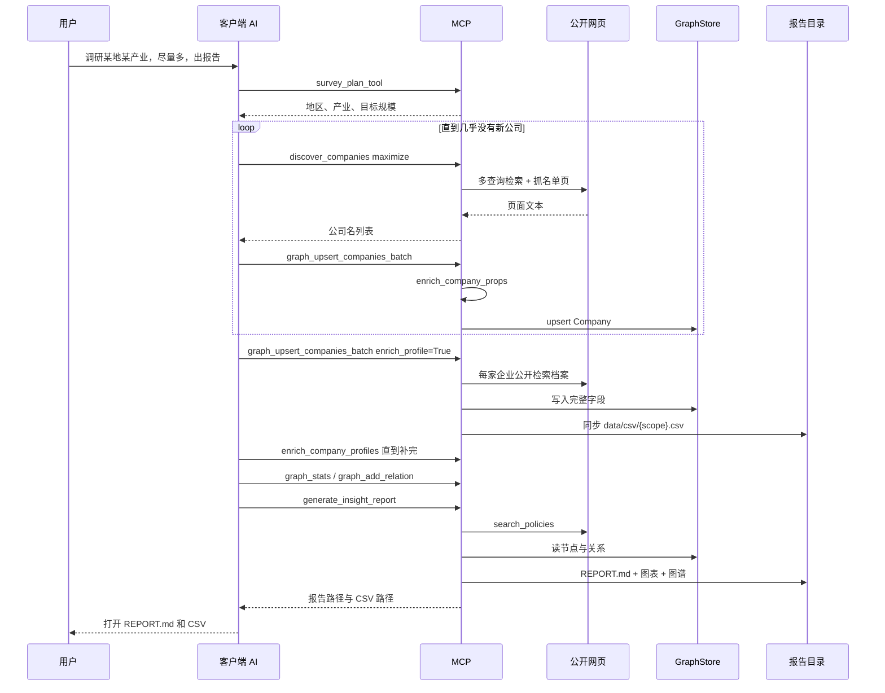
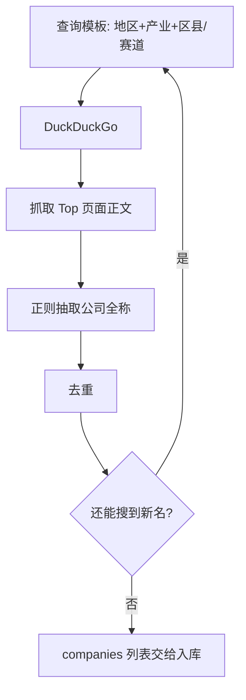
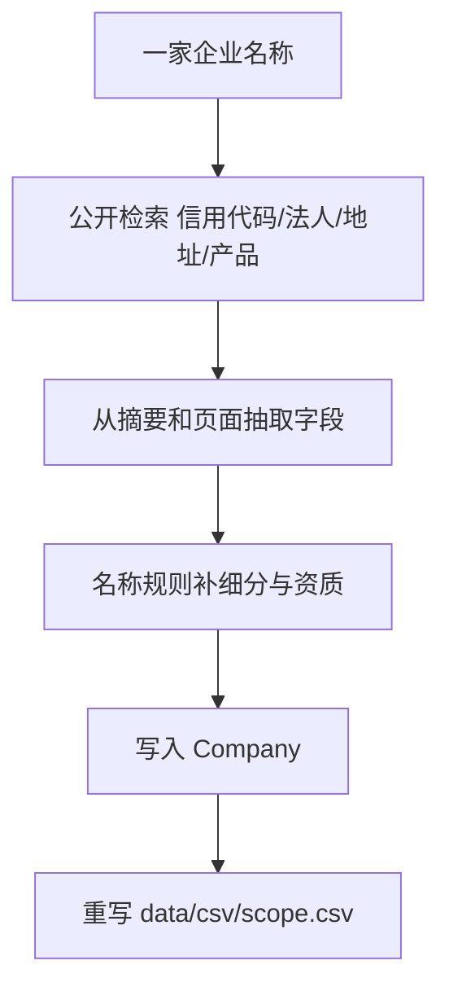
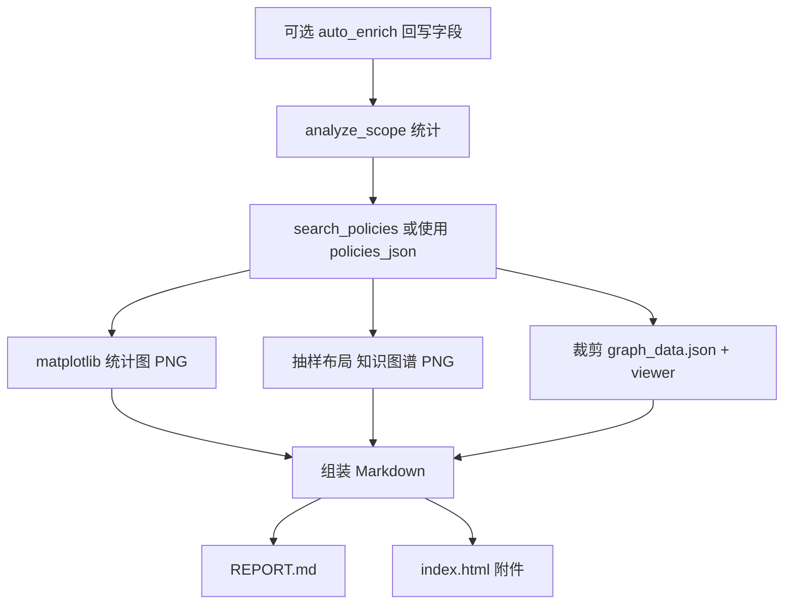
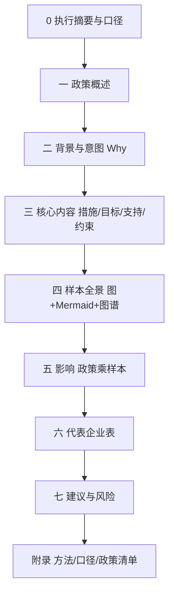
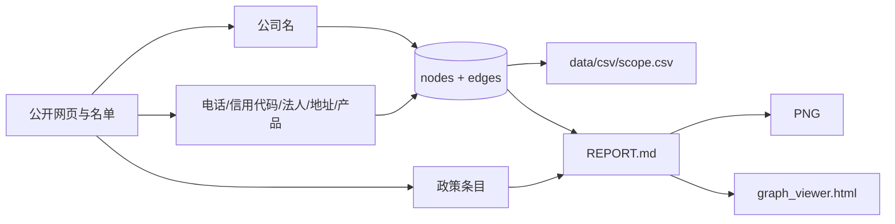
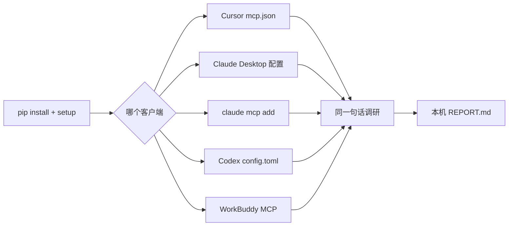

# 产业图谱 MCP 全流程说明

> 版本：industry-graph-mcp **0.6.0**  
> 协议：MCP stdio（任意支持本地 MCP 的客户端拉起本机进程）  
> 数据根目录：`D:\industry-graph-mcp`  
> 代码：`D:\工作\项目\民政局\industry-graph-mcp`（Anaconda 3.11 editable 安装）

## 1. 技术架构

客户端不直接搜网页、不直接写库。Cursor、Claude Code、Claude Desktop、Codex、WorkBuddy 都只负责编排；通过 MCP stdio 把工具调用发给本机 Python 进程。进程读写 `D:\industry-graph-mcp`。



### 1.1 运行时

| 项 | 实现 |
|---|---|
| 入口 | `python -m industry_graph_mcp mcp` → `mcp_server.main` |
| 框架 | `mcp` FastMCP（`mcp>=1.2,<2`），stdio |
| 解释器 | `D:\anaconda3\python.exe`（Python 3.11） |
| 配置 | `INDUSTRY_GRAPH_MCP_HOME`；否则默认 `D:\industry-graph-mcp` |
| 客户端 | 不绑定 Cursor。凡是能启动本地 stdio MCP 的都可以，见第 7 节 |

### 1.2 代码模块

| 模块 | 职责 |
|---|---|
| `mcp_server.py` | 对外工具：发现、入库、档案补全、CSV、查询、报告 |
| `search_fetch.py` | DuckDuckGo 检索、页面抽取（direct / jina / archive） |
| `discover.py` | 多查询 + 名单页抓取 + 正则抽公司全称 |
| `sources/policy.py` 等 | 政策 / 招投标 / 专利公开检索 |
| `schema.py` | 标准企业字段与中文表头 |
| `enrich.py` | 名称关键词推断细分与角色 |
| `company_profile.py` | 入库时公开检索补全一家企业的档案字段 |
| `csv_export.py` | 按标准表头写出 `data/csv/{scope}.csv` |
| `graph/store.py` | 统一接口 |
| `graph/sqlite_store.py` | 默认后端 |
| `graph/neo4j_store.py` | 可选后端 |
| `report/analytics.py` | 按 scope 统计分布、Top 企业 |
| `report/charts.py` | matplotlib 出 PNG |
| `report/graph_image.py` | 抽样知识图谱 PNG |
| `report/insight_builder.py` | 组装政策解读 + 产业洞察 Markdown / HTML |

### 1.3 图谱存储

默认 SQLite，两张表，属性用 JSON 字符串：

- `nodes`：主键 `(id, scope)`，字段 `labels`、`properties`、`updated_at`
- `edges`：`source_id`、`target_id`、`rel_type`、`properties`、`scope`

常见标签：`Company`、`Industry`、`Region`。  
常见关系：企业所属地区/产业，以及补全后的 `IN_SUB_INDUSTRY`。

同一套 `GraphStore` 可切 Neo4j，工具层不改调用方式。无 Neo4j 时走 SQLite。

## 2. 一次调研的时序



## 3. 业务步骤

数据按 **scope** 分区，常用 `地区_产业`，例如 `杭州_科技`。


### 3.1 意图解析

`survey_plan_tool` 从自然语言抽出地区、产业、目标规模（默认尽量多，常按 500+ 起）。

### 3.2 发现企业

`discover_companies(maximize=True, max_companies=500+)`：

1. 按地区、产业、区县、细分赛道拼多条查询  
2. `do_search` 取结果，`do_fetch` 抓名单页正文  
3. 正则匹配「……有限公司 / 股份有限公司」等全称并去重  

辅助工具：`web_search`、`fetch_url`、`search_tenders`、`search_patents`、`search_policies`。  
一轮不够就换区县或赛道再挖，直到几乎没有新名字。



### 3.3 入库时就补全一家企业

发现到公司名之后，不要只存名称。`graph_upsert_companies_batch` 和 `graph_upsert_company` 默认 `enrich_profile=True`：对每一家做公开网页检索，能抽到的标准字段都写入节点，并立刻重写 CSV。

补全来源只有公开检索和页面正文，不用付费工商库。页面上没有的格子留空，`筛选标记` 为 `profile_partial`；主要字段都有则为 `profile_complete`。

名称规则仍会填细分和角色：

- 细分小类：已有明确值则保留；否则用名称关键词（半导体、生物医药、软件……）；推不出记「科技（未细分）」
- 单位资质：种子名单（龙头/独角兽等）优先；否则按来源（高新、专精特新、拟上市）

旧库继续补：反复调用 `enrich_company_profiles(scope, limit=50)`，直到本轮 `updated=0`。只要还有空字段就会再搜。`graph_enrich_fields` 只回写细分/角色，不代替档案补全。随时可用 `graph_export_csv(scope)` 重导表。



#### 标准 CSV 表头

与北京科技养老主表同一套列，文件在 `D:\industry-graph-mcp\data\csv\{scope}.csv`（Excel 用 UTF-8 BOM）：

| 列 | 含义 |
|---|---|
| 序号 | 导出行号 |
| 企业名称 | 公司全称 |
| 联系电话 | 公开页出现的电话 |
| 统一社会信用代码 | 18 位代码 |
| 法人 | 法定代表人 |
| 成立日期 | 公开页出现的成立时间 |
| 注册资本(万) | 注册资本，单位万 |
| 所属区县 | 区县 |
| 注册街道 | 街道或镇 |
| 注册地址 | 住所 / 注册地址 |
| 核心技术/产品/服务 | 产品或技术简述 |
| 产业链 | 上游 / 中游 / 下游（粗分） |
| 细分小类 | 赛道，含名称推断 |
| 所获专利 | 公开提及的专利情况 |
| 单位资质 | 高新、专精特新、角色等 |
| 获得荣誉 | 公开荣誉表述 |
| 企业风险 | 公开风险提示，多数为空 |
| 分类理由 | 字段从哪来、细分怎么判 |
| 数据来源 | 名单来源 + public_web_enrich |
| 筛选标记 | profile_complete 或 profile_partial |

### 3.4 关系、统计、看图

- `graph_add_relation`：企业与产业、地区等有向边  
- `graph_stats` / `graph_query` / `graph_query_relations`  
- `graph_open_viewer`：导出 JSON + HTML，用浏览器打开  
- `graph_export`：整图 JSON  

### 3.5 出报告

`generate_insight_report` 内部顺序：



主文件：`D:\industry-graph-mcp\reports\{scope}\{时间}_insight\REPORT.md`

同目录还有同名标题 `.md`、`index.html`、`meta.json`，以及 `assets/`（统计图、`knowledge_graph.png`、`graph_viewer.html`、`policies.json`）。

## 4. 报告章节

模板 = 国内产业政策解读 + 区域产业样本洞察。



| 章节 | 技术来源 |
|---|---|
| 政策概述、摘录、附录清单 | `search_policies` 多查询去重，优先 gov.cn |
| 背景、工具箱、建议框架 | 报告模板固定提纲，细则以检索摘要和原文为准 |
| 规模、细分、角色、区县、连接度 | `analytics.analyze_scope` |
| 柱状/饼图 | `charts.render_charts`（matplotlib Agg） |
| 产业示意 | Markdown 内 Mermaid |
| 图谱抽样 | `graph_image` + `assets/graph_viewer.html` |
| 企业表 | 连接度与角色优先级 Top N |

## 5. 数据落盘

```text
D:\industry-graph-mcp\
  config.json
  data\graph.db
  data\csv\{scope}.csv   标准中文企业表，与图谱同步
  data\viewer\          全局图谱浏览器
  cache\
  reports\{scope}\{ts}_insight\
  SKILL.md
  产业图谱MCP全流程.md   本文
```



## 6. 口径

- 公开检索样本不是工商全量，也不是付费企业库。信用代码、法人、电话、地址以公开页面能抽到的为限，抽不到就空着。  
- 名称推断的细分和角色不是工商或工信官方分类。  
- 政策摘要必须核对原文、文号和是否现行有效。  
- 图谱连接度不是市场份额。  
- 杭州已入库的旧名单不会自动重跑全量补全，需要对 scope 反复调用 `enrich_company_profiles`。

## 7. 别人怎么体验

MCP 是本机进程，不绑某一种聊天软件。对方用 Cursor、Claude Code、Claude Desktop、Codex 或 WorkBuddy 都可以，只要那个客户端能启动：

```text
python -m industry_graph_mcp mcp
```

并带上环境变量 `INDUSTRY_GRAPH_MCP_HOME`（默认 `D:\industry-graph-mcp`）。

Windows 可以一条命令装好并写入已安装的客户端配置：

```powershell
irm https://raw.githubusercontent.com/192tt/industry-graph-mcp/master/deploy-dist/install.ps1 | iex
```

### 7.1 安装（各客户端相同）

需要 Python 3.10 或 3.11，以及公网。

```powershell
git clone https://github.com/192tt/industry-graph-mcp.git
cd industry-graph-mcp
py -3.11 -m pip install -e .
py -3.11 -m industry_graph_mcp setup -y --backend sqlite
py -3.11 -c "import sys; print(sys.executable)"
```

最后一行打印的路径，就是下面配置里的 `command`。没有 D 盘时先执行：

```powershell
$env:INDUSTRY_GRAPH_MCP_HOME = "$env:USERPROFILE\industry-graph-mcp"
```

然后再 `setup`。图谱和报告写在这个目录，不进 Git 仓库。

### 7.2 接到不同客户端

配置内容一样，只是文件位置不同。`command` 用上一步打印的 Python。

**Cursor**：`%USERPROFILE%\.cursor\mcp.json`

```json
{
  "mcpServers": {
    "industry-graph-mcp": {
      "command": "C:\\Path\\To\\python.exe",
      "args": ["-m", "industry_graph_mcp", "mcp"],
      "env": { "INDUSTRY_GRAPH_MCP_HOME": "D:\\industry-graph-mcp" }
    }
  }
}
```

改完后在 MCP 设置里 Reload，或重启 Cursor。

**Claude Desktop**：`%APPDATA%\Claude\claude_desktop_config.json`，`mcpServers` 段与上面相同。保存后退出并重新打开 Claude Desktop。

**Claude Code**（终端）：

```powershell
claude mcp add industry-graph-mcp --env INDUSTRY_GRAPH_MCP_HOME=D:\industry-graph-mcp -- py -3.11 -m industry_graph_mcp mcp
```

**Codex**：在 `%USERPROFILE%\.codex\config.toml` 增加：

```toml
[mcp_servers.industry-graph-mcp]
command = "C:\\Path\\To\\python.exe"
args = ["-m", "industry_graph_mcp", "mcp"]

[mcp_servers.industry-graph-mcp.env]
INDUSTRY_GRAPH_MCP_HOME = "D:\\industry-graph-mcp"
```

**WorkBuddy**：在其 MCP 配置里添加同一条 command / args / env。把仓库里的 `SKILL.md` 放进 Agent 技能，方便一句话编排。

ChatGPT 网页不能直接拉起本机进程，需要 Secure MCP Tunnel，见仓库 `configs/chatgpt_tunnel.md`。

### 7.3 对话里怎么说

在已接上 MCP 的对话里发：

> 调研杭州科技企业，企业尽量多，最后出政策解读和产业洞察报告。

对方不用记工具名。客户端里的模型会发现企业、入库时补全档案、写出 CSV、检索政策并生成 `generate_insight_report`。

### 7.4 看结果

企业表：

```text
D:\industry-graph-mcp\data\csv\杭州_科技.csv
```

报告：

```text
D:\industry-graph-mcp\reports\杭州_科技\<时间>_insight\REPORT.md
```

统计图和图谱在报告目录 `assets\`。交互图打开 `assets\graph_viewer.html`。让模型调用 `ping`，`version` 应为 **0.6.0**。

体验时看四件事：企业数是否增加、CSV 是否是中文标准表头、能公开查到的电话/信用代码/地址是否写入、报告是否包含政策解读和产业样本图。若 CSV 正被 Excel 打开导致写不进去，先关掉再让模型调用 `graph_export_csv`。



## 8. 工具对照

| 阶段 | 工具 |
|---|---|
| 健康检查 | `ping` |
| 计划 | `survey_plan_tool` |
| 发现 | `discover_companies`、`web_search`、`fetch_url` |
| 侧面检索 | `search_policies`、`search_tenders`、`search_patents` |
| 入库（默认补全档案并写 CSV） | `graph_upsert_companies_batch`、`graph_upsert_company`、`graph_import_csv`、`graph_import_json` |
| 继续补全空字段 | `enrich_company_profiles` |
| 只补细分/角色 | `graph_enrich_fields` |
| 导出企业表 | `graph_export_csv` |
| 图谱 | `graph_add_relation`、`graph_query`、`graph_query_relations`、`graph_stats`、`graph_open_viewer`、`graph_export`、`graph_delete` |
| 报告 | `generate_insight_report`、`save_report_tool`、`list_reports_tool` |
